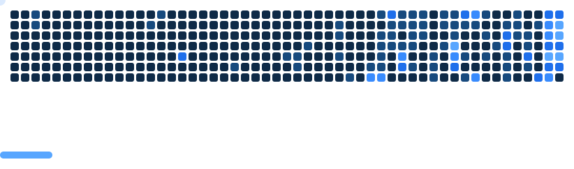

<h1 align="center">
  
</h1>

  

## :computer: Tech Stack

### Frontend

### API & Integration

### Tools

### Build & Package Tools

## :chart_with_upwards_trend: Current Stats

 

  

## 📊 Activity Graph

## 📈 Contribution Activity

